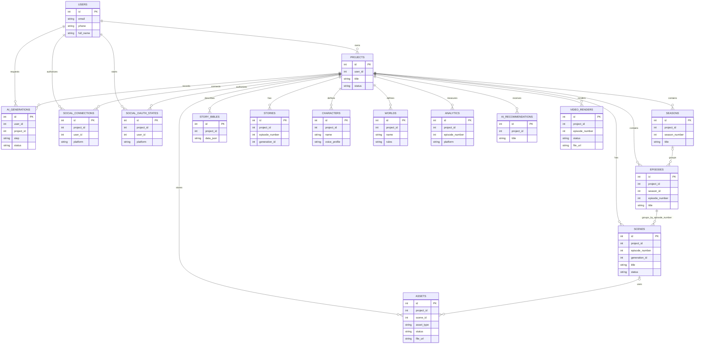

# Use Cases và ERD logic CINAI

Tài liệu này mô tả các luồng hiện có trong ứng dụng và quan hệ logic giữa
các bảng. Data layer hiện tạo schema trực tiếp; các quan hệ trong ERD không
đồng nghĩa rằng mọi khóa ngoại đều được khai báo hoặc cưỡng chế ở database.

## Actors

- **Creator:** đăng nhập, quản lý dự án, tạo và duyệt nội dung, nhập/xem số liệu.
- **AI/media providers:** tạo nội dung, ảnh hoặc giọng đọc khi được cấu hình.
- **Mạng xã hội:** cấp OAuth và dữ liệu analytics theo quyền của ứng dụng.
- **FFmpeg:** dựng video từ tư liệu đã duyệt.

## Use cases

| ID | Use case | Kết quả |
|---|---|---|
| UC-01 | Đăng ký/đăng nhập | Creator xác minh OTP hoặc dùng Google OAuth đã cấu hình; phiên được lưu bằng cookie HttpOnly. |
| UC-02 | Quản lý dự án | Creator tạo, chọn và xóa dự án của mình; dữ liệu API được kiểm tra quyền sở hữu. |
| UC-03 | Phát triển câu chuyện | Creator nhập ý tưởng, tạo concept/Story Bible/kịch bản, chỉnh sửa và xem lịch sử AI. |
| UC-04 | Quản lý season, episode, scene | Creator tạo và quản lý tập, bối cảnh, nhân vật và phân cảnh; phân cảnh có thể sửa, xóa và gắn với tập. |
| UC-05 | Tạo media | Creator yêu cầu tạo ảnh hoặc giọng đọc cho cảnh; theo dõi trạng thái, duyệt hoặc thử lại. Provider cần được cấu hình. |
| UC-06 | Dựng video | Creator yêu cầu render tập bằng FFmpeg khi các cảnh có ảnh và âm thanh đã duyệt; xem hoặc tải MP4/SRT. |
| UC-07 | Phân tích hiệu quả | Creator nhập analytics thủ công/CSV hoặc đồng bộ nền tảng đã kết nối, rồi yêu cầu AI tạo gợi ý. |
| UC-08 | Kết nối mạng xã hội | Creator kết nối tài khoản qua OAuth. Nền tảng chỉ trả về chỉ số được phép; CINAI chưa tự xuất bản video. |

## ERD logic

`episode_number` hiện là khóa liên kết logic giữa `episodes`, `stories`,
`scenes`, `analytics` và `video_renders`; `generation_id` liên kết nội dung
được tạo với lịch sử tương ứng. Cần duy trì kiểm tra project ownership ở API,
không suy ra quyền truy cập chỉ từ ID tài nguyên.

## Chưa được mô tả như tính năng đã hoàn thành

- Upload media thủ công và nghe thử voice nhân vật độc lập.
- Thanh toán/gói thuê bao, xuất bản video tự động, trang chính sách và kênh liên hệ.
- Ảnh chụp, video demo, cùng xác minh end-to-end trên provider thật.
